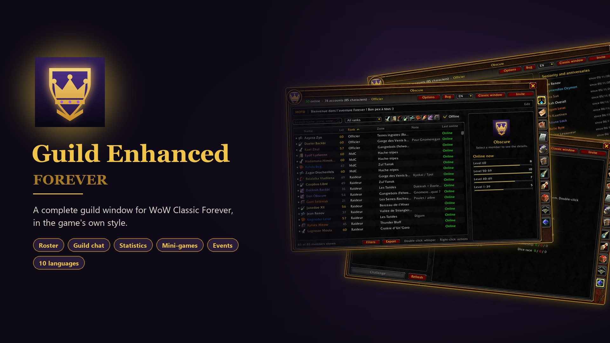
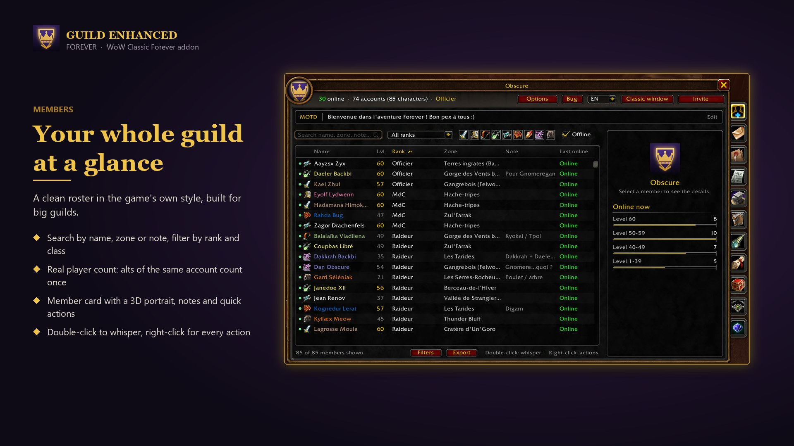
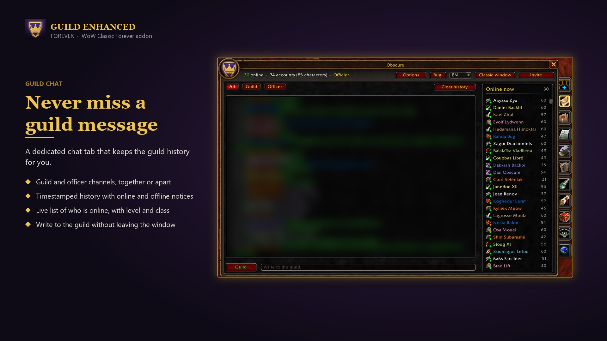
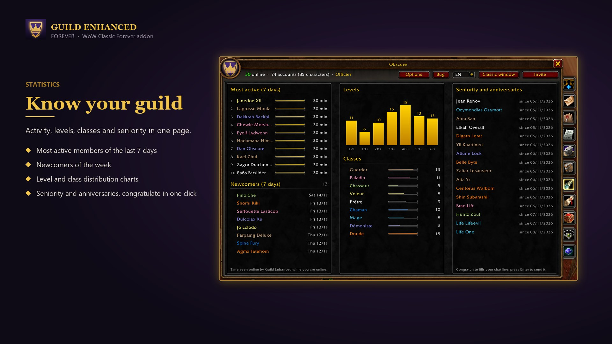
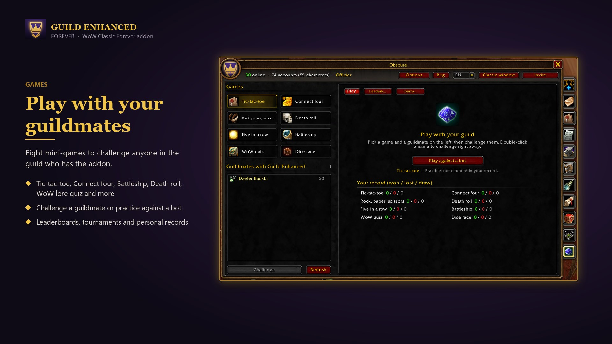

  

<h1 align="center">Guild Enhanced Forever</h1>

  <strong>A complete replacement for the guild window, in the game's own style, for WoW Forever.</strong> 
  <em>Un remplacement complet de la fenêtre de guilde, dans le style du jeu, pour WoW Forever.</em>

  <a href="#english">English</a> · <a href="#français">Français</a>

  

## English

Guild Enhanced Forever replaces the guild window (J) of World of Warcraft: Forever. It keeps the look of the game's own windows and adds everything a guild needs in one place: roster, chat, announcements, events, professions, statistics and mini-games.

### Features

- **Roster:** search by name, zone or note, filter by rank, class and online status, sort any column. Double-click to whisper, right-click for every action.
- **Member card:** rank, level, zone, notes, last online and a 3D portrait when the player is near you.
- **Real player count:** the number of accounts in the guild, with the alts of the same account counted once (read from `/ginfo`).
- **Guild chat:** guild and officer messages kept between sessions, without the online and offline spam, and the list of members online.
- **Board:** announcements from the officers, pinned first, with a pop-up for new ones.
- **Events:** a guild calendar with Present / Maybe / Absent, roles and a waiting list, plus a group finder.
- **Professions:** pick a profession to see the guildmates who have it, their level and their recipes, and send craft requests.
- **Information:** message of the day, guild information, overview tiles and class composition.
- **Statistics:** most active members of the week, newcomers, level and class charts, seniority and anniversaries.
- **Log, news and ranks:** joins, departures, promotions, guild news with item tooltips, and members by rank.
- **Mini-games:** Tic-tac-toe, Connect four, Rock paper scissors, Death roll, Five in a row, Battleship, a WoW lore quiz and Dice race. Challenge a guildmate or practice against a bot, with leaderboards and tournaments.
- **Native interface:** the windows, tabs and buttons of the game.
- **10 languages:** English, French, German, Spanish, Italian, Portuguese, Russian, Korean, Simplified and Traditional Chinese.

Shared features (board, events, professions, games, join dates) work between guildmates who have the addon.

### Screenshots

    
    
    
  

### Installation

Copy the `Guild_Enhanced_Forever` folder into `Interface\AddOns`, then restart the game. Press J to open the window.

### Commands

| Command | What it does |
|---|---|
| `/gui` | Open or close the window |
| `/gui blizzard` | J opens the game's guild window instead (toggle) |
| `/gui scale <0.6-1.6>` | Change the window size |
| `/gui reset` | Reset the window position |
| `/gui help` | List the commands |

`/guildui` and `/guildenhanced` work too.

## Français

Guild Enhanced Forever remplace la fenêtre de guilde (J) de World of Warcraft: Forever. Il garde le look des fenêtres du jeu et réunit tout ce dont une guilde a besoin : membres, chat, annonces, événements, métiers, statistiques et mini-jeux.

### Fonctionnalités

- **Membres :** recherche par nom, zone ou note, filtres par rang, classe et présence, tri sur chaque colonne. Double-clic pour chuchoter, clic droit pour toutes les actions.
- **Fiche membre :** rang, niveau, zone, notes, dernière connexion et portrait 3D quand le joueur est près de vous.
- **Vrai nombre de joueurs :** le nombre de comptes de la guilde, les rerolls d'un même compte comptés une seule fois (lu depuis `/ginfo`).
- **Chat de guilde :** messages de guilde et d'officiers gardés entre les sessions, sans le spam des connexions et déconnexions, et liste des membres en ligne.
- **Tableau :** annonces des officiers, épinglées en premier, avec une fenêtre pour les nouvelles.
- **Événements :** calendrier de guilde avec Présent / Peut-être / Absent, rôles et liste d'attente, plus une recherche de groupe.
- **Métiers :** choisissez un métier pour voir les membres qui l'ont, leur niveau et leurs recettes, et envoyez des demandes de fabrication.
- **Informations :** message du jour, informations de guilde, vue d'ensemble et composition des classes.
- **Statistiques :** membres les plus actifs de la semaine, nouveaux venus, graphiques de niveaux et de classes, ancienneté et anniversaires.
- **Journal, actualités et rangs :** arrivées, départs, promotions, actualités de guilde avec infobulles d'objets, et membres par rang.
- **Mini-jeux :** morpion, puissance 4, pierre-feuille-ciseaux, death roll, cinq en ligne, bataille navale, quiz sur le lore de WoW et course de dés. Défiez un membre de la guilde ou entraînez-vous contre un bot, avec classements et tournois.
- **Interface native :** les fenêtres, onglets et boutons du jeu.
- **10 langues :** anglais, français, allemand, espagnol, italien, portugais, russe, coréen, chinois simplifié et traditionnel.

Les fonctions partagées (tableau, événements, métiers, jeux, dates d'arrivée) marchent entre les membres qui ont l'addon.

### Installation

Copiez le dossier `Guild_Enhanced_Forever` dans `Interface\AddOns`, puis relancez le jeu. Appuyez sur J pour ouvrir la fenêtre.

### Commandes

| Commande | Effet |
|---|---|
| `/gui` | Ouvre ou ferme la fenêtre |
| `/gui blizzard` | J ouvre la fenêtre de guilde du jeu à la place (bascule) |
| `/gui scale <0.6-1.6>` | Change la taille de la fenêtre |
| `/gui reset` | Remet la fenêtre à sa place |
| `/gui help` | Liste les commandes |

`/guildui` et `/guildenhanced` marchent aussi.
